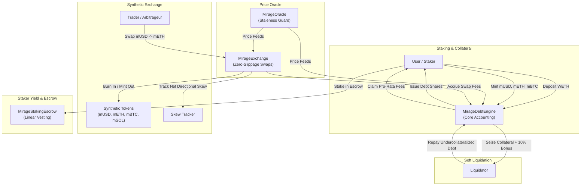

# MirageDelta

[](https://github.com/ZengLLQ/mirage-delta/actions/workflows/ci.yml)
[](LICENSE)
[](https://github.com/vyperlang/vyper)
[](https://getfoundry.sh/)

**MirageDelta** is a production-grade, multi-collateral synthetic asset and delta-neutral debt protocol implemented in **Vyper 0.4.3** with automated testing and formal property fuzzing via **Foundry**.

The protocol allows users to stake volatile collateral (e.g. WETH) to mint an array of synthetic assets (`mUSD`, `mETH`, `mBTC`, `mSOL`). It features **virtual debt share accounting**, **zero-slippage virtual synthetic swaps**, **directional skew-adaptive funding fees**, a non-cascading **soft-liquidation stabilization engine**, and an $O(1)$ discrete master reward accumulator for staker yield distribution.

---

## Architecture Overview



---

## Core Protocol Contracts

| Contract | Language | Runtime Size | Runtime Margin | Description |
| :--- | :--- | :--- | :--- | :--- |
| **`MirageDebtEngine.vy`** | Vyper 0.4.3 | **12,304 B** | 12,272 B | Core multi-collateral vault, virtual debt shares, global debt index, and soft-liquidation engine. |
| **`MirageExchange.vy`** | Vyper 0.4.3 | **5,046 B** | 19,530 B | Zero-slippage virtual synthetic exchange with dynamic skew-adaptive fee engine. |
| **`MirageOracle.vy`** | Vyper 0.4.3 | **3,405 B** | 21,171 B | Centralized price feed router with heartbeat/staleness validation and batch updates. |
| **`MirageStakingEscrow.vy`** | Vyper 0.4.3 | **3,998 B** | 20,578 B | Continuous linear vesting and reward escrow with cliff enforcement. |
| **`MirageToken.vy`** | Vyper 0.4.3 | **3,723 B** | 20,853 B | Standard ERC-20 implementation for synthetic tokens with multi-minter authorizations. |

*All contracts are compiled with Vyper 0.4.3 and strictly adhere to the EVM 24.576 KB bytecode limit.*

---

## Mathematical Formulations

### 1. Global Virtual Debt Share Accounting

To eliminate iterative loops when collateral prices fluctuate, debt is partitioned into virtual debt shares using a continuously updated global debt index $I_D(t)$:

$$\text{TotalDebt}(t) = \sum_{k \in \text{Synths}} S_k(t) \cdot P_k(t)$$

$$I_D(t) = \begin{cases} 
1.0 \cdot 10^{18} & \text{if } \text{TotalDebtShares} = 0 \\
\frac{\text{TotalDebt}(t) \cdot 10^{18}}{\text{TotalDebtShares}(t)} & \text{if } \text{TotalDebtShares} > 0 
\end{cases}$$

When a user mints debt of nominal value $V_{mint}$:

$$\Delta \text{Shares}_{user} = \frac{V_{mint} \cdot 10^{18}}{I_D(t)}$$

At any time $t$, the user's outstanding debt obligation is evaluated in $O(1)$ operations:

$$D_{user}(t) = \frac{\text{Shares}_{user} \cdot I_D(t)}{10^{18}}$$

**Invariant Proof**: $\sum_u D_u(t) \equiv \text{TotalDebt}(t)$ within integer rounding bounds.

---

### 2. Collateralization Ratio (C-Ratio) & Solvency Bounds

For a given user with deposited collateral balance $C_{user}$ evaluated at oracle price $P_{col}$:

$$V_{col}(t) = \frac{C_{user} \cdot P_{col}(t)}{10^{18}}$$

$$\text{C-Ratio}_{user}(t) = \frac{V_{col}(t) \cdot 10^{18}}{D_{user}(t)}$$

- **Target C-Ratio ($C_{target}$)**: $400\%$ ($4.0 \cdot 10^{18}$). Required for minting new synths or withdrawing collateral.
- **Liquidation C-Ratio ($C_{liq}$)**: $150\%$ ($1.5 \cdot 10^{18}$). Triggers soft-liquidation eligibility when breached.

---

### 3. Skew-Adaptive Dynamic Swap Fees

Swaps execute at exact oracle exchange rates with zero price slippage, but are subject to a dynamic fee $\gamma(t)$ that expands when traders accumulate directional exposure:

$$\text{GrossUSD} = \frac{\text{Amount}_{in} \cdot P_{in}}{10^{18}}$$

$$\gamma(t) = \text{clamp}\left(\gamma_{base} + \mathbf{1}_{\{\text{Skew}_{out} > 0\}} \cdot \gamma_{skew}, \, \gamma_{base}, \, \gamma_{max}\right)$$

Where:
- $\gamma_{base} = 30\text{ bps}$ ($0.30\%$)
- $\gamma_{skew} = 50\text{ bps}$ ($0.50\%$)
- $\gamma_{max} = 300\text{ bps}$ ($3.00\%$)

$$\text{FeeUSD} = \frac{\text{GrossUSD} \cdot \gamma(t)}{10000}, \quad \text{Amount}_{out} = \frac{(\text{GrossUSD} - \text{FeeUSD}) \cdot 10^{18}}{P_{out}}$$

---

### 4. Non-Cascading Soft-Liquidation Stabilization

Instead of dumping 100% of collateral in Dutch auctions, MirageDelta uses a bounded soft-liquidation mechanism:

$$\text{MaxCover} = \frac{D_{user} \cdot \text{CloseFactorBps}}{10000} \quad (\text{CloseFactorBps} = 5000 \text{ or } 50\%)$$

$$\Delta D = \min(\text{CoverOffered}, \text{MaxCover})$$

The liquidator receives collateral at a discounted rate reflecting a $10\%$ liquidation bonus:

$$C_{seized} = \frac{\Delta D \cdot (1 + \text{Bonus}) \cdot 10^{18}}{P_{col}}$$

This immediately restores the borrower's position to a healthy C-Ratio $> 150\%$ without causing cascading insolvencies.

---

### 5. $O(1)$ Master Reward Accumulator

Trading fees from `MirageExchange` are routed directly to the fee accumulator:

$$R_{acc}(t) = R_{acc}(t_{prev}) + \frac{\Delta \text{Fees} \cdot 10^{18}}{\text{TotalDebtShares}}$$

Stakers claim accrued fees in $O(1)$ time without iterative loops:

$$\text{Claimable}_u = \frac{\text{Shares}_u \cdot (R_{acc}(t) - \text{LastFeeIndex}_u)}{10^{18}}$$

---

## Test Suite & Verification Results

The protocol test suite is built on **Foundry** with Solidity integration wrappers and fuzzing properties.

```bash
forge test -vvv --fuzz-runs 256
```

### Test Results Breakdown (23 / 23 Passing)

```
Ran 23 tests for test/MirageDelta.t.sol:MirageDeltaTest
[PASS] testFuzz_interleaved_deposits_and_debt_solvency(uint256,uint256) (runs: 256, μ: 406154, ~: 406255)
[PASS] testFuzz_multi_user_debt_proportionality(uint256,uint256) (runs: 256, μ: 620981, ~: 621041)
[PASS] testFuzz_oracle_staleness_protection(uint256) (runs: 256, μ: 24966, ~: 25098)
[PASS] testFuzz_swap_conservation_and_fee_bounds(uint256) (runs: 256, μ: 47611, ~: 47648)
[PASS] test_admin_ownership_transfer_lifecycle() (gas: 109918)
[PASS] test_admin_parameter_updates_and_guards() (gas: 144098)
[PASS] test_burn_synths_reduces_debt_shares() (gas: 462125)
[PASS] test_cannot_mint_beyond_target_c_ratio() (gas: 222554)
[PASS] test_cannot_withdraw_collateral_if_c_ratio_breached() (gas: 406157)
[PASS] test_collateral_deposit_and_accounting() (gas: 204356)
[PASS] test_collateral_withdrawal_with_no_debt() (gas: 233783)
[PASS] test_continuous_vesting_schedule_and_claim() (gas: 757155)
[PASS] test_debt_index_adjusts_when_synths_appreciate() (gas: 506431)
[PASS] test_escrow_cancel_schedule_refunds_unclaimed() (gas: 721037)
[PASS] test_exchange_dynamic_skew_surcharge() (gas: 649149)
[PASS] test_initial_parameters_and_wiring() (gas: 105554)
[PASS] test_mint_synths_within_target_c_ratio() (gas: 363574)
[PASS] test_multi_synth_minting_and_debt_tracking() (gas: 555011)
[PASS] test_oracle_batch_price_updates() (gas: 92269)
[PASS] test_soft_liquidation_of_undercollateralized_position() (gas: 917415)
[PASS] test_staker_reward_accrual_and_claiming() (gas: 940114)
[PASS] test_swap_reverts_on_slippage_or_paused() (gas: 458243)
[PASS] test_synthetic_swap_zero_slippage_with_fee() (gas: 634941)
Suite result: ok. 23 passed; 0 failed; 0 skipped; finished in 99.96ms
```

---

## Installation & Environment Setup

### Prerequisites
- [Foundry](https://getfoundry.sh/) (`forge`, `cast`, `anvil`)
- [Python 3.10+](https://www.python.org/) with `vyper==0.4.3`:
  ```bash
  pip install vyper==0.4.3
  vyper --version
  ```

### Build & Test

```bash
# Clone the repository
git clone https://github.com/ZengLLQ/mirage-delta.git
cd mirage-delta

# Check Vyper compiler output
for f in src/*.vy; do vyper -f bytecode,abi $f > /dev/null; done

# Verify contract sizes
forge build --sizes

# Run test suite with 256 fuzz runs per invariant
forge test -vvv --fuzz-runs 256

# Verify deterministic deployment script
forge script script/DeployMirageDelta.s.sol
```

---

## Security Model & Invariant Checklist

- **No Inheritance or Modifiers**: Built in Vyper to eliminate shadowing vulnerabilities, complex inheritance graphs, and modifier reentrancy gaps.
- **Reentrancy Protection**: Strictly follows the Checks-Effects-Interactions (CEI) pattern across all external token interactions.
- **Oracle Staleness Guards**: Enforces `block.timestamp - last_update <= max_stale_duration` (default 3,600s) on all price queries.
- **Close Factor Bounds**: Caps single-transaction liquidation coverage at 50% to prevent predatory full liquidations and preserve user capital.
- **Zero-Secret Guarantee**: No private keys, mnemonic phrases, or secret RPC credentials are embedded in this repository.

---

## Known Limitations & Design Trade-offs

1. **Discrete vs Continuous Skew Decay**: Directional skew currently updates atomically upon each swap; continuous exponential time-decay of skew can be layered for long-duration imbalance dissipation.
2. **Oracle Architecture**: The current deployment uses an admin-controlled multisig reporter oracle; production mainnet deployments should pair Pyth Network and Chainlink Data Feeds with medianized deviation filters.

---

## License

This project is licensed under the [MIT License](LICENSE).
